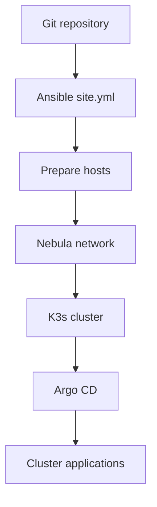
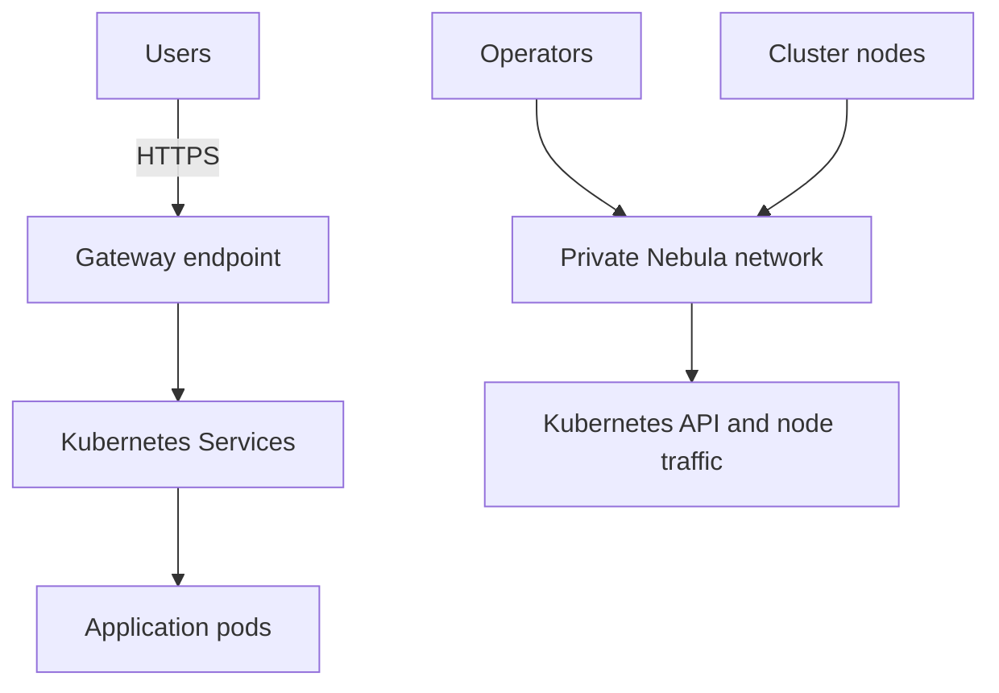
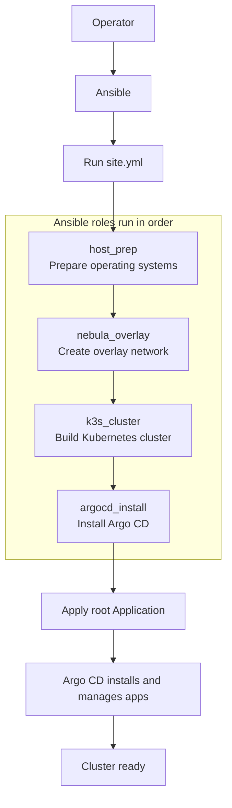
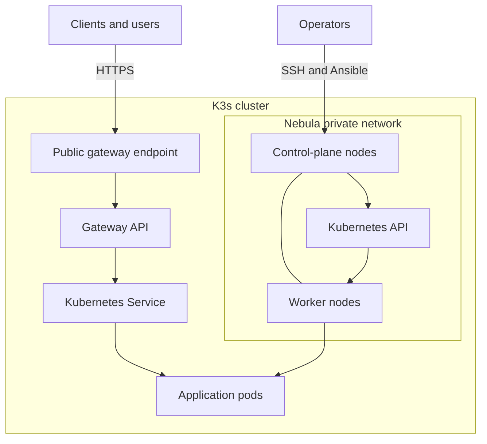

# K3s Cluster Bootstrap

## TL;DR

Bootstrap and maintain a Debian-based K3s cluster.
Ansible prepares hosts, builds the private network, installs K3s, and hands application management to Argo CD.

**Bootstrap flow:**



- **Toolchain:** Ansible, Nebula, K3s, Helm, Argo CD, OpenBao, ESO, Gateway
  API, and cert-manager.
- **Public access:** Users enter through the cluster gateway endpoint; traffic
  is routed to Kubernetes Services and application pods.
- **Private access:** Operators and cluster nodes communicate over the
  encrypted Nebula network.
- **Deployment secrets:** Ansible Vault protects sensitive inventory values
  used during bootstrap.
- **Application secrets:** OpenBao stores runtime secrets; ESO synchronizes
  them into Kubernetes so applications do not need direct OpenBao access.
- **Never commit:** Vault passwords, private keys, OpenBao unseal keys, and
  root tokens.
- **Start here:** [`ansible/site.yml`](ansible/site.yml), the
  [`ansible/inventory/prod/`](ansible/inventory/prod/) directory, and
  [`argocd/root-bootstrap-app.yaml`](argocd/root-bootstrap-app.yaml).

**Traffic overview:**



Infrastructure-as-code repository for building and maintaining a small,
self-hosted K3s cluster on Debian-family servers.

The repository combines:

- **Ansible** for host preparation, Nebula networking, K3s installation, Argo
  CD installation, and optional OpenBao bootstrap.
- **Nebula** as the encrypted overlay network used for node-to-node traffic.
- **K3s** as the lightweight Kubernetes distribution.
- **Argo CD** for GitOps management.
- **OpenBao** and External Secrets for secret delivery to Kubernetes.

## Architecture

### 1. Abstract lifecycle

This view shows only the main path from operator action to a ready cluster.



### 2. How traffic reaches the cluster

Two traffic paths matter to users:

- **Public application traffic:** users reach an application through the
  public entry point and Gateway API.
- **Private administration traffic:** operators and cluster nodes communicate
  through SSH and the encrypted Nebula network.



The K3s cluster exposes one public gateway endpoint for application users.
Requests follow `endpoint -> Gateway API -> Kubernetes Service -> application
pods`. Nebula is a separate private network inside the cluster for control
plane, worker-node, Kubernetes API, and operator traffic; it is not the public
application entry point.

### Execution order

`site.yml` runs these stages:

1. Build dynamic inventory from the central host lists.
2. Prepare every Nebula/K3s host.
3. Generate or reuse the Nebula CA and per-host certificates, then start
   Nebula.
4. Install K3s one host at a time. The first control-plane host initializes
   the cluster; later control planes and workers join it.
5. Install Helm and Argo CD on the first control-plane host.
6. Apply the Argo CD root Application. Argo CD then reconciles
   `argocd/infrastructure/`.
7. Optionally initialize OpenBao and configure its Kubernetes authentication.

K3s uses `nebula1` for Flannel and advertises the Nebula address. Traefik is
disabled; ingress and Gateway API components are managed through Argo CD.

## Prerequisites

### Workstation

Install:

- Git
- Python 3
- Ansible
- `pre-commit`
- `nebula-cert`, available in `PATH`

The Nebula certificate tool must support `nebula-cert ca` and
`nebula-cert sign`. Use a binary matching the workstation architecture.

### Target servers

Every target server must:

- Run a supported Debian-family operating system.
- Be reachable over SSH as `root` using `~/.ssh/id_ed25519`, or use the
  private key configured in `ansible/ansible.cfg`.
- Have a stable hostname and network access to download K3s, Helm, Nebula,
  and required container images.
- Allow Nebula UDP traffic on port `4242` between nodes.
- Allow Kubernetes API traffic on port `6443` over the Nebula network.

The host-preparation role installs base packages, disables swap, configures
kernel parameters, and limits journald disk usage.

## Fresh cluster: nothing exists yet

### 1. Clone and enter repository

```bash
git clone https://github.com/kianukroll/pub-k3s-cluster-bootstrap.git
cd pub-k3s-cluster-bootstrap
```

### 2. Create local secret tooling

Create `ansible/.vault_pass` locally. This file is ignored by Git and must
never be committed:

```bash
printf '%s\n' 'REPLACE_WITH_LONG_RANDOM_PASSWORD' > ansible/.vault_pass
chmod 600 ansible/.vault_pass
```

Keep the vault password in a password manager. Do not place plaintext secrets
in public inventory files.

### 3. Define cluster topology

Edit
`ansible/inventory/prod/group_vars/all/10-cluster-hosts.yml`:

```yaml
k3s_control_plane_hosts:
  - REPLACE_WITH_CONTROL_PLANE_01_HOSTNAME
k3s_worker_hosts:
  - REPLACE_WITH_WORKER_01_HOSTNAME
  - REPLACE_WITH_WORKER_02_HOSTNAME
```

Use the exact SSH host names. A host cannot appear in both lists. At least one
control-plane host is required. Uppercase `REPLACE_WITH_...` values are
placeholders; replace every one with the real hostname before running Ansible.

### 4. Define Nebula host addresses and credentials

Edit the encrypted Nebula vault file:

```bash
cd ansible
ansible-vault edit inventory/prod/group_vars/nebula_nodes/99-vault.yml
```

Set values matching the non-secret configuration in
`inventory/prod/group_vars/nebula_nodes/10-nebula.yml`, especially:

- Nebula lighthouse overlay IP.
- Lighthouse public IP or reachable endpoint.
- `nebula_host_config`, with one unique Nebula IP per cluster host.

Example structure:

```yaml
nebula_lighthouse_ip: 10.42.0.1
nebula_lighthouse_public_ip: 203.0.113.10
nebula_host_config:
  REPLACE_WITH_CONTROL_PLANE_01_HOSTNAME:
    nebula_ip: 10.42.0.10
  REPLACE_WITH_WORKER_01_HOSTNAME:
    nebula_ip: 10.42.0.11
  REPLACE_WITH_WORKER_02_HOSTNAME:
    nebula_ip: 10.42.0.12
```

The actual values belong in the encrypted file, not in this README.

Ensure the local Nebula CA files do not exist as an incomplete pair:

```text
ansible/credentials/nebula/ca.crt
ansible/credentials/nebula/ca.key
```

If absent, Ansible generates them locally. It also generates one certificate
and key per host. These files are ignored by Git; back them up securely because
losing the CA prevents issuing compatible certificates for future nodes.

### 5. Set K3s and Argo CD secrets

Edit encrypted K3s variables:

```bash
ansible-vault edit inventory/prod/group_vars/k3s_cluster/99-vault.yml
```

Set a strong `k3s_token`. Set the Argo CD admin password hash in the encrypted
variable `argocd_admin_password_hash`. Generate the bcrypt value locally:

```bash
htpasswd -bnBC 10 dummy 'REPLACE_WITH_ADMIN_PASSWORD' | cut -d: -f2
```

Update non-secret `argocd_admin_password_mtime` in
`inventory/prod/group_vars/k3s_cluster/40-argocd.yml` whenever the password
changes.

OpenBao is installed by Argo CD. Keep
`openbao_bootstrap_enabled: false` for the first run unless the encrypted
bootstrap flow is intentionally being used. OpenBao initialization produces
unseal keys and a root token; store them in a protected password manager, never
in Git or shell history.

### 6. Validate and run bootstrap

From `ansible/`:

```bash
ansible-playbook -i inventory/prod/hosts.yml site.yml --syntax-check
ansible-playbook -i inventory/prod/hosts.yml site.yml
```

`ansible.cfg` automatically uses `.vault_pass` and `~/.ssh/id_ed25519`.
Override either setting through standard Ansible options when required.

The playbook is intentionally serialized for K3s installation. Wait for the
run to finish before changing topology or restarting nodes.

### 7. Verify cluster and GitOps bootstrap

SSH to the first control-plane host:

```bash
ssh root@REPLACE_WITH_CONTROL_PLANE_01_HOSTNAME
export KUBECONFIG=/etc/rancher/k3s/k3s.yaml
kubectl get nodes -o wide
kubectl get pods --all-namespaces
kubectl get applications -n argocd
```

Expected results:

- Every configured node is `Ready`.
- Argo CD pods are running in `argocd`.
- `infrastructure-bootstrap` becomes `Synced` and `Healthy`.
- Argo CD creates the infrastructure applications and namespaces.

For local Argo CD access, use the existing port-forward pattern documented in
[`argocd/infrastructure/00-core/00-argocd/README.md`](argocd/infrastructure/00-core/00-argocd/README.md).

### 8. Initialize OpenBao, when enabled

OpenBao initialization is a separate security-sensitive operation. Follow the
full procedure in
[`argocd/infrastructure/01-security/00-openbao/README.md`](argocd/infrastructure/01-security/00-openbao/README.md).

The minimum sequence is:

1. Confirm the OpenBao pod is running.
2. Initialize once for its persistent data store.
3. Store all unseal keys and the initial root token securely.
4. Unseal with the configured threshold of keys.
5. Configure Kubernetes auth, policy, and the `eso-role`.
6. Verify `ClusterSecretStore` and `ExternalSecret` resources.

## Add nodes to an existing cluster

Adding nodes uses the same playbook. Existing nodes remain members; only the
inventory and encrypted Nebula data need updating.

### 1. Prepare new server

Provision a Debian-family server with SSH root access. Give it a unique
hostname and a unique Nebula IP. Do not reuse an existing certificate or
Nebula address.

### 2. Add host to topology

Update
`ansible/inventory/prod/group_vars/all/10-cluster-hosts.yml`.

For a worker:

```yaml
k3s_worker_hosts:
  - REPLACE_WITH_WORKER_01_HOSTNAME
  - REPLACE_WITH_WORKER_02_HOSTNAME
  - REPLACE_WITH_WORKER_03_HOSTNAME
```

For an additional control plane:

```yaml
k3s_control_plane_hosts:
  - REPLACE_WITH_CONTROL_PLANE_01_HOSTNAME
  - REPLACE_WITH_CONTROL_PLANE_02_HOSTNAME
```

Additional control-plane nodes join the first control plane as K3s servers.
Plan an odd number of control-plane nodes for quorum. This repository does not
automatically migrate storage or workloads between nodes.

### 3. Add encrypted Nebula configuration

Add the new host and unique overlay address to
`ansible/inventory/prod/group_vars/nebula_nodes/99-vault.yml`:

```yaml
nebula_host_config:
  REPLACE_WITH_CONTROL_PLANE_01_HOSTNAME:
    nebula_ip: 10.42.0.10
  REPLACE_WITH_WORKER_03_HOSTNAME:
    nebula_ip: 10.42.0.13
```

Do not manually create the host certificate unless required. The Nebula role
generates it from the existing CA during the next run and installs it on the
new server.

### 4. Run the playbook

From `ansible/`:

```bash
ansible-playbook -i inventory/prod/hosts.yml site.yml
```

All hosts run preparation and Nebula tasks. K3s runs one host at a time; the
new host waits for the first control-plane API, then joins using the shared
K3s token. Argo CD and OpenBao bootstrap tasks run only on the first control
plane, so existing cluster services are not duplicated.

For a targeted expansion after validating the inventory:

```bash
ansible-playbook -i inventory/prod/hosts.yml site.yml --tags prep,nebula,k3s
```

Run the full playbook when Argo CD or OpenBao variables also changed.

### 5. Verify expansion

```bash
ssh root@REPLACE_WITH_CONTROL_PLANE_01_HOSTNAME \
  'KUBECONFIG=/etc/rancher/k3s/k3s.yaml kubectl get nodes -o wide'
```

Confirm the new node is `Ready`, has the expected Nebula IP, and can schedule
the intended workloads. Review `kubectl describe node <node-name>` if it
remains `NotReady`.

## Operations and maintenance

### Re-run safely

The roles are designed for repeatable runs. Re-running the playbook:

- Reuses existing Nebula CA and host certificates.
- Leaves installed K3s at the requested pinned version.
- Reconciles host preparation and service configuration.
- Upgrades or installs the pinned Helm and Argo CD versions.
- Re-applies the Argo CD root Application.

Change pinned versions in the relevant inventory files, review release
compatibility, then run the playbook deliberately.

### Vault handling

Use Ansible Vault for all sensitive values:

```bash
ansible-vault edit inventory/prod/group_vars/k3s_cluster/99-vault.yml
ansible-vault view inventory/prod/group_vars/nebula_nodes/99-vault.yml
```

Before committing:

```bash
./scripts/encrypt-ansible-vault-files.sh
pre-commit run --all-files
```

Never commit `ansible/.vault_pass`, Nebula private keys, plaintext vault files,
unseal keys, or OpenBao root tokens.

### Useful checks

```bash
cd ansible
ansible-inventory --graph
ansible-playbook -i inventory/prod/hosts.yml site.yml --list-hosts
ansible-playbook -i inventory/prod/hosts.yml site.yml --check
```

The check mode cannot predict every package, service, or cluster-side change,
but it catches many inventory and variable errors before a real run.

## Known boundaries

- Host preparation currently supports Debian-family operating systems only.
- K3s storage defaults to `local-path`; it is not replicated storage.
- Nebula CA and private keys require secure backup outside Git.
- OpenBao unseal keys are not stored or auto-unsealed by this repository.
- Argo CD tracks the `main` branch from the configured GitHub repository.
- The default bootstrap disables Traefik and expects networking through the
  Argo CD-managed Gateway API stack.
